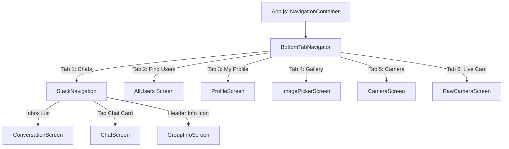

# CampusConnect 🎓📱

> A modern, lightweight campus communication and peer-to-peer collaboration mobile application built with **React Native (Expo SDK 58)** and a **Node.js / Express REST API**.

---

## 📌 Table of Contents
- [1. Problem Statement](#1-problem-statement)
- [2. Features Overview](#2-features-overview)
- [3. Application Architecture](#3-application-architecture)
- [4. Navigation & User Flow](#4-navigation--user-flow)
- [5. Backend REST API Contract](#5-backend-rest-api-contract)
- [6. Project Directory Structure](#6-project-directory-structure)
- [7. Local Setup & Development](#7-local-setup--development)
- [8. Cloud Deployment (Render.com)](#8-cloud-deployment-rendercom)
- [9. Standalone Android APK Build & Google Drive Distribution](#9-standalone-android-apk-build--google-drive-distribution)
- [10. Testing & Error Resilience](#10-testing--error-resilience)
- [11. Viva Defense & Academic Documentation](#11-viva-defense--academic-documentation)

---

## 1. Problem Statement

On university and college campuses, academic discussions, study groups, and faculty notices are frequently fragmented across multiple commercial social media platforms (WhatsApp, Telegram, Discord). This leads to several challenges:
- **Privacy Concerns:** Students are forced to expose personal phone numbers to join class groups.
- **Distraction & Clutter:** Academic messages are mixed with personal chats, resulting in missed assignment deadlines and exam notices.
- **Lack of Campus Identity:** Commercial apps lack verified student directories, student ID attributions, and dedicated campus announcement noticeboards.

**CampusConnect** solves this by providing a dedicated, student-centric communication application. It unifies peer discovery, 1-on-1 direct messaging, study group collaboration, official broadcast announcements, and whiteboard/notes camera sharing into a single mobile client.

---

## 2. Features Overview

| Feature | Description |
|---|---|
| **💬 Conversations Inbox** | Unified message list displaying direct chats, study groups, and campus noticeboards with real-time previews, unread badges, and focus-based auto-refresh. |
| **🔍 Search & Filter** | Instant client-side search across conversations and students by title, creator, or bio, with dedicated category chips (*All, DMs, Groups, 📢 Notices*). |
| **👥 Student Directory & Discovery** | Interactive campus directory allowing students to find classmates and initiate direct messages or collaborative study groups. |
| **🛡️ Duplicate Prevention** | Interactive multi-user selection toggle prevents duplicate participant IDs and enforces validation rules (1 recipient for DM; title + participants for Groups). |
| **✉️ Core Chat Thread** | Sent vs. received bubble styling (sent in brand blue on the right, received in clean white on the left), sender identification, and formatted timestamps. |
| **🔄 Auto-Refresh & Polling** | Focus-based refreshes (`useFocusEffect`) combined with a 5-second polling interval for real-time peer messaging without demanding complex WebSocket servers. |
| **📷 Integrated Media Sharing** | Dual photo sourcing allowing students to capture whiteboard notes via the **Camera** or select assignment screenshots from the **Photo Gallery** with cancellation crash guards and preview confirmation. |
| **ℹ️ Group Information** | View group metadata, participant counts, creator attribution, and resolved classmate profiles directly via the chat header info icon (`ℹ️`). |
| **👤 Student Profile & Viva Switcher** | Dedicated profile screen showing student ID, bio, active chat statistics, and an identity switcher to demonstrate multi-user interaction on a single test device. |
| **📢 Campus Announcements** | Distinctive gold-accented noticeboard cards for official departmental announcements and broadcast alerts. |

---

## 3. Application Architecture

CampusConnect follows a clean, decoupled **Layered Client-Server Architecture**:

```
┌────────────────────────────────────────────────────────────────────────┐
│                   CAMPUSCONNECT CLIENT (EXPO / REACT NATIVE)           │
├────────────────────────────────────────────────────────────────────────┤
│ 1. Presentation Layer (Screens & Reusable Components)                  │
│    - Screens: ConversationScreen, ChatScreen, AllUsers, ProfileScreen, │
│               GroupInfoScreen, CameraScreen, RawCameraScreen           │
│    - UI Components: MessageBubble, ConversationCard, UserItem,         │
│                     LoadingIndicator, ErrorMessage                     │
├────────────────────────────────────────────────────────────────────────┤
│ 2. Navigation Layer (React Navigation 7)                               │
│    - BottomTabNavigator: [Chats, Find Users, My Profile, Utilities]    │
│    - NativeStackNavigator: [ConversationInbox -> ActiveChat -> Info]  │
├────────────────────────────────────────────────────────────────────────┤
│ 3. Service Layer (src/services/api.js)                                 │
│    - Encapsulated REST methods: getUsers, getConversations,            │
│      createConversation, getMessages, sendTextMessage, sendImageMessage│
│    - AbortController 10s timeout protection & HTTP status validation   │
├────────────────────────────────────────────────────────────────────────┤
│ 4. Configuration & Utilities                                           │
│    - src/config/api.js (Single configurable BASE_URL)                  │
│    - src/utils/formatters.js (Timestamp & initials formatting)         │
└───────────────────────────────────┬────────────────────────────────────┘
                                    │ HTTP REST (JSON & Base64)
                                    ▼
┌────────────────────────────────────────────────────────────────────────┐
│                      NODE.JS / EXPRESS BACKEND                         │
│  - Port: process.env.PORT || 3000                                      │
│  - Middleware: CORS, express.json(limit: '50mb' for Base64 photos)     │
│  - Endpoints: /user, /user/profile, /conversation, /message            │
└────────────────────────────────────────────────────────────────────────┘
```

---

## 4. Navigation & User Flow



### End-to-End Message Flow
$$\text{User Types Message} \longrightarrow \text{UI Validates Non-Empty} \longrightarrow \text{POST /message} \longrightarrow \text{Backend DB} \longrightarrow \text{UI Auto-Refreshes Thread}$$

---

## 5. Backend REST API Contract

The application communicates exclusively via standard HTTP REST endpoints. Authentication uses HTTP Basic Auth headers or open development access.

| Feature | Endpoint | Method | Request Format / Body | Response Schema |
|---|---|---|---|---|
| **Health Check** | `/` | `GET` | None | `{ status: "online", app: "CampusConnect", version: "1.0.0" }` |
| **All Users** | `/user` | `GET` | Headers: `Content-Type: application/json` | `[ { id, name, bio } ]` |
| **User Profile** | `/user/profile?user_id={id}` | `GET` | Query param `user_id` | `{ id, name, bio }` |
| **Conversations** | `/conversation` | `GET` | None | `[ { id, name, type, createdBy, participants_ids } ]` |
| **Create Chat** | `/conversation` | `POST` | `{ type: "DM"\|"GROUP", name, participants_ids: [...] }` | Created conversation object `{ id, ... }` |
| **Fetch Messages**| `/message?conversation_id={id}`| `GET` | Query param `conversation_id` | `{ data: [ { id, content, imageInfo, senderId, createdAt } ] }` |
| **Send Text** | `/message` | `POST` | `{ conversation_id, content }` | Created message acknowledgement |
| **Send Photo** | `/message` | `POST` | `{ conversation_id, imageInfo: "data:image/jpeg;base64,..." }` | Created message acknowledgement |

---

## 6. Project Directory Structure

```
NST_AD/
├── backend/                              # Production Node.js / Express backend
│   ├── package.json                      # Backend dependencies (express, cors)
│   └── server.js                         # REST API implementation & pre-seeded data
├── chat_app/                             # Mobile Client (Expo SDK 58 / React Native)
│   ├── assets/                           # App icons, splash screens, adaptive icons
│   ├── screens/                          # Screen Components
│   │   ├── AllUsers.jsx                  # Student discovery & conversation creation
│   │   ├── CameraScreen.jsx              # System OS Camera intent integration
│   │   ├── ChatScreen.jsx                # Core chat thread & composer
│   │   ├── ConversationScreen.jsx        # Inbox list, category chips & search
│   │   ├── GroupInfoScreen.jsx           # Group metadata & member directory
│   │   ├── ImagePicker.jsx               # System media gallery test screen
│   │   ├── ProfileScreen.jsx             # Student profile & demo identity switcher
│   │   ├── RawCameraScreen.jsx           # Custom in-app CameraView viewfinder
│   │   └── Stack.jsx                     # Stack Navigator (Chats -> Thread -> Info)
│   ├── src/
│   │   ├── components/                   # Reusable UI Components
│   │   │   ├── ConversationCard.jsx      # Conversation item row with badges
│   │   │   ├── ErrorMessage.jsx          # Error notice banner with Retry action
│   │   │   ├── LoadingIndicator.jsx      # Activity spinner with status text
│   │   │   ├── MessageBubble.jsx         # Sent/Received message bubbles & photos
│   │   │   └── UserItem.jsx              # User directory row with selection checkbox
│   │   ├── config/
│   │   │   └── api.js                    # Centralized BASE_URL configuration
│   │   ├── services/
│   │   │   └── api.js                    # Fetch wrapper with AbortController timeout
│   │   └── utils/
│   │       └── formatters.js             # Initials, date/time & text truncation
│   ├── test/
│   │   └── run_tests.js                  # Automated functional & error resilience tests
│   ├── App.js                            # App root: SafeAreaProvider & Tab Navigator
│   ├── app.json                          # Expo application manifest & permissions
│   ├── eas.json                          # EAS build configuration (outputs standalone APK)
│   └── package.json                      # Client dependencies & scripts
├── docs/                                 # Comprehensive Academic Documentation
│   ├── PROJECT_AUDIT.md                  # Stage 0 detailed audit report & bug inventory
│   ├── VIVA_NOTES.md                     # 14-section comprehensive viva defense notes
│   ├── VIVA_QUESTIONS.md                 # 25 likely viva examination questions & answers
│   └── SUBMISSION_CHECKLIST.md           # Submission verification & APK testing guide
└── README.md                             # Professional project documentation
```

---

## 7. Local Setup & Development

### Prerequisites
- [Node.js](https://nodejs.org/) (v18 or higher recommended)
- [Expo Go](https://expo.dev/go) installed on your physical Android phone (or an Android emulator)
- [Android Platform Tools (ADB)](https://developer.android.com/studio/releases/platform-tools)

### Step 1: Start the Backend Server
```bash
cd backend
npm install
npm start
```
*The server will start on `http://localhost:3000`.*

### Step 2: Connect via Physical Android Phone (USB)
1. Enable **Developer Options** and **USB Debugging** on your phone.
2. Connect your phone to your computer via USB and run:
   ```bash
   adb reverse tcp:3000 tcp:3000
   ```
   *(This routes requests made to `localhost:3000` on the phone directly to your computer's server).*

### Step 3: Start the Mobile Application
```bash
cd chat_app
npm install
npx expo start
```
Scan the displayed QR code using the **Expo Go** app on your phone.

---

## 8. Cloud Deployment (Render.com)

To make CampusConnect accessible 24/7 on any phone without requiring USB cables or local servers:

1. Push this repository to **GitHub**.
2. Go to **[https://render.com](https://render.com)** and sign in with GitHub.
3. Click **New + $\rightarrow$ Web Service** $\rightarrow$ select your repository.
4. Fill in the deployment settings:
   - **Name:** `campusconnect-api`
   - **Root Directory:** `backend`
   - **Environment:** `Node`
   - **Build Command:** `npm install`
   - **Start Command:** `node server.js`
   - **Instance Type:** `Free`
5. Click **Deploy Web Service**. Render will assign a live HTTPS URL (e.g., `https://campusconnect-api.onrender.com`).
6. Update [chat_app/src/config/api.js](file:///Users/shreyashgolhani/Desktop/NST_AD/chat_app/src/config/api.js):
   ```javascript
   export const API_CONFIG = {
     BASE_URL: 'https://campusconnect-api.onrender.com',
     TIMEOUT_MS: 15000,
     DEFAULT_HEADERS: { 'Content-Type': 'application/json' },
   };
   ```

---

## 9. Standalone Android APK Build & Google Drive Distribution

To compile a standalone `.apk` that your evaluator or instructor can download from Google Drive and install directly on their Android phone:

### Step 1: Install EAS CLI & Log In
```bash
npm install -g eas-cli
cd chat_app
eas login
```

### Step 2: Trigger Standalone APK Cloud Build
```bash
eas build -p android --profile preview
```
*Select **Yes** when asked to generate a new Android Keystore.*

### Step 3: Download & Upload to Google Drive
1. EAS will build the `.apk` in the cloud and provide a download link upon completion.
2. Download `CampusConnect.apk` and upload it to your **Google Drive**.
3. Set link sharing to **"Anyone with the link can view/download"**.

### Step 4: Sideloading Instructions for Evaluators
When installing the APK on an Android device:
1. Tap on `CampusConnect.apk` in Google Drive / Downloads.
2. If prompted *"For your security, your phone is not allowed to install unknown apps"*, tap **Settings** $\rightarrow$ enable **Allow from this source**.
3. If Google Play Protect warns *"Unrecognized app"*, tap **More details** $\rightarrow$ **Install anyway**.

---

## 10. Testing & Error Resilience

An automated verification suite checks functional logic and error handling:

```bash
node chat_app/test/run_tests.js
```

### Verified Test Cases:
- **`getInitials()`:** Correctly formats single and multi-word names into uppercase initials.
- **`truncateText()`:** Truncates message previews cleanly with an ellipsis.
- **`formatMessageTime()`:** Gracefully handles invalid dates and formats timestamps into `HH:MM AM/PM`.
- **Toggle Selection & Deduplication:** Tapping a user selects them; tapping again deselects them. Strictly blocks duplicate participant IDs.
- **Conversation Form Validation:** Enforces single-recipient DMs and requires group names and participants for groups.
- **Error Resilience:** Blocks empty/whitespace-only messages and guards against photo picker cancellation crashes.

---

## 📄 License
This project is developed for educational and academic submission purposes under the **MIT License**.

