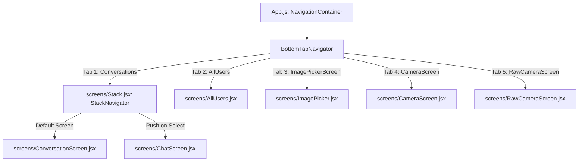

# STAGE 0 — Project and Backend Audit Report: CampusConnect (NST_AD)

**Project Name:** CampusConnect (formerly `chat_app`)  
**Workspace:** `chat_app`  
**Current Tech Stack:** Expo SDK ~58.0.20, React Native 0.88.0, React 19.3.0, React Navigation 7.x  
**Language:** JavaScript (ES6+ / JSX)  
**Audit Date:** November 2026  

---

## 1. Executive Summary

CampusConnect is an existing mobile chat application developed using Expo and React Native. The codebase serves as a prototype for student and campus communication. 

The audit evaluated the codebase under the strict requirements of Stage 0:
- **No complete rewrites**
- **No migration to TypeScript**
- **No external backend substitutions (e.g., Firebase, Supabase)**
- **Preservation of all functional features**
- **Strict adherence to verified backend contracts**

The audit reveals that while the core architectural primitives (Navigation, REST API communication via `fetch`, and media access via Expo plugins) are present, the application is in an unstable state. There are critical runtime crash bugs (e.g., image picker cancellation, missing imports), severe networking inconsistencies (divergent backend IPs), insecure credential handling (hardcoded Basic Auth headers), and unrendered chat messages.

---

## 2. Existing Architecture & Project Structure

### 2.1 File System Structure

```
chat_app/
├── assets/                       # Static app icons & splash images
│   ├── icon.png
│   ├── splash-icon.png
│   └── ...
├── screens/                      # Screen components
│   ├── AllUsers.jsx              # User discovery & conversation initiation
│   ├── CameraScreen.jsx          # Native camera UI using ImagePicker
│   ├── ChatScreen.jsx            # Active conversation message thread & composer
│   ├── ConversationScreen.jsx    # Conversation inbox list
│   ├── ImagePicker.jsx           # Standalone media picker test screen
│   ├── RawCameraScreen.jsx       # Custom camera viewfinder using expo-camera
│   └── Stack.jsx                 # Native Stack Navigator for Conversations -> Chat
├── App.js                        # App root: Tab Navigator setup
├── app.json                      # Expo application manifest
├── index.js                      # Entry point registering root component
├── package.json                  # Dependencies & scripts
└── tsconfig.json                 # Type check configuration (JS project)
```

### 2.2 Core Dependencies

| Package | Version | Purpose |
|---|---|---|
| `expo` | `~58.0.20` | Core framework runtime |
| `react` | `19.3.0` | React core library |
| `react-native` | `0.88.0` | Mobile UI primitive runtime |
| `@react-navigation/native` | `^7.5.1` | Navigation container and routing state |
| `@react-navigation/bottom-tabs` | `^7.21.0` | Bottom tab bar navigation |
| `@react-navigation/native-stack` | `^7.21.0` | Native stack transitions between screens |
| `expo-camera` | `~58.0.14` | In-app camera hardware access |
| `expo-image-picker` | `~58.0.10` | System photo library and camera intent picker |
| `expo-file-system` | `~58.0.13` | Local file manipulation (currently unused) |
| `expo-status-bar` | `~58.0.4` | Native status bar styling |
| `react-native-safe-area-context`| `^5.11.0` | Handles device notches and home indicators |

---

## 3. Screen & Navigation Flow

### 3.1 Navigation Hierarchy



### 3.2 Navigation Analysis & Observations

1. **Incorrect Initial Tab Route:** In `App.js`, `Tab.Navigator` is initialized with `initialRouteName="ImagePickerScreen"`. When a user launches the app, it lands on an isolated photo picker testing screen rather than the main `Conversations` list.
2. **Exposed Development/Test Screens:** Three of the five bottom tabs (`ImagePickerScreen`, `CameraScreen`, `RawCameraScreen`) are standalone test prototypes that are not connected to the messaging workflow.
3. **Parameter Passing Fragility:** `Stack.jsx` configures the `Chat` screen title dynamically via `route.params.data.name ?? 'Unknow Name'`. If `route.params` or `route.params.data` is missing or undefined, this throws an uncaught error before the screen mounts.

---

## 4. Backend Communication & API Contract

### 4.1 Identified Server Addresses
The source code contains two distinct hardcoded private LAN IP addresses on port 3000:
- `http://10.7.1.89:3000` — Used for fetching users, fetching conversations, fetching messages, sending messages, and user profile queries.
- `http://10.7.1.51:3000` — Used in `screens/AllUsers.jsx` exclusively for creating new conversations (`POST /conversation`).

> **Critical Note:** Using different IP addresses across screens indicates an inconsistent local development environment. If the developer machine or server IP changed, conversation creation fails while other features target an older IP.

### 4.2 Authentication Scheme
All requests use HTTP Basic Authentication:
- Header: `Authorization: Basic [REDACTED]` (configured as raw string `'Basic first:second'`).
- Inconsistent header key casing: `ConversationScreen.jsx` and `AllUsers.jsx` (GET) use lowercase `authorization`, whereas `ChatScreen.jsx` and `AllUsers.jsx` (POST) use uppercase `Authorization`.

### 4.3 Verified API Contract Table

| Feature | Endpoint | Method | Request Format / Headers | Expected Response Format |
|---|---|---|---|---|
| **Fetch All Users** | `/user` | `GET` | **Headers:**<br>`authorization: Basic [REDACTED]` | **JSON Array:**<br>`[ { "id": "...", "name": "...", "bio": "..." } ]` |
| **Fetch User Profile** | `/user/profile?user_id={id}` | `GET` | **Headers:**<br>`Authorization: Basic [REDACTED]` | **JSON Object:**<br>`{ "id": "...", "name": "...", ... }` |
| **Fetch Conversations** | `/conversation` | `GET` | **Headers:**<br>`authorization: Basic [REDACTED]` | **JSON Array:**<br>`[ { "id": "...", "name": "...", "createdBy": "...", "participants_ids": ["..."] } ]` |
| **Create Conversation** | `/conversation` | `POST` | **Headers:**<br>`Authorization: Basic [REDACTED]`<br>`Content-Type: application/json`<br>**Body:**<br>`{ "type": "DM" \| "GROUP", "name": string, "participants_ids": string[] }` | **JSON Object / Acknowledgement:**<br>`{ "id": "...", "name": "...", ... }` |
| **Fetch Messages** | `/message?conversation_id={id}` | `GET` | **Headers:**<br>`authorization: Basic [REDACTED]` | **JSON Object with data array:**<br>`{ "data": [ { "id": "...", "content": "...", "imageInfo": "...", ... } ] }` |
| **Send Text Message** | `/message` | `POST` | **Headers:**<br>`Authorization: Basic [REDACTED]`<br>`Content-Type: application/json`<br>**Body:**<br>`{ "conversation_id": string, "content": string }` | **JSON Object / Acknowledgement** |
| **Send Image Message** | `/message` | `POST` | **Headers:**<br>`Authorization: Basic [REDACTED]`<br>`Content-Type: application/json`<br>**Body:**<br>`{ "conversation_id": string, "imageInfo": string (Base64) }` | **JSON Object / Acknowledgement** |

---

## 5. Functionality Assessment Matrix

| Feature | Audit Classification | Analysis & Justification |
|---|---|---|
| **User Listing** | **Partially Working** | Fetches users from `GET /user` and renders list; however, IP is hardcoded, UI is crude, and error states cause runtime exceptions. |
| **Conversation Listing** | **Partially Working** | Fetches conversations from `GET /conversation`; resolves creator names using an inefficient N+1 query loop (`/user/profile?user_id=...`); lacks pull-to-refresh and empty-state messaging. |
| **Direct Conversation (DM)** | **Partially Working / Broken** | Endpoints and payloads exist, but points to wrong IP `10.7.1.51:3000`; user selection does not prevent duplicates; does not enforce DM participant limit (2 users); lacks success navigation. |
| **Group Conversation** | **Partially Working / Broken** | Supports `type: 'GROUP'` and group name input, but points to wrong IP `10.7.1.51:3000`; lacks validation and user deselection. |
| **Text Message Sending** | **Partially Working** | Can POST `{ conversation_id, content }` to `/message`, but does not refresh message thread upon sending, allows blank/whitespace messages, and uses placeholder text fallback. |
| **Message Fetching** | **Partially Working** | Successfully calls `GET /message?conversation_id=...`, but **completely fails to render message text**: `ChatScreen.jsx` renders `<Text></Text>` empty if not an image! |
| **Image Upload & Display** | **Broken** | Crashes fatally if user cancels photo picker (`result.assets[0]` accessed unconditionally); missing `Alert` import; sends huge raw Base64 strings in JSON body. |
| **Camera & Gallery Access** | **Partially Working** | Hardware permission requests and camera/picker invocations work in isolation inside test screens (`CameraScreen`, `RawCameraScreen`, `ImagePicker`), but are not integrated into the chat UI. |

---

## 6. Bugs, Vulnerabilities, and Technical Risks

### 6.1 Fatal Runtime Crash Bugs
1. **Unconditional Asset Access on Picker Cancellation:**  
   In both `screens/ImagePicker.jsx` (line 36) and `screens/ChatScreen.jsx` (lines 68, 70), `setImage(result.assets[0].uri)` executes even when `result.canceled === true`. When a user cancels the picker, `result.assets` is `undefined`, causing `TypeError: Cannot read properties of undefined (reading '0')` and crashing the application.
2. **Missing `Alert` Import in `ChatScreen.jsx`:**  
   In `screens/ChatScreen.jsx` (line 50), `Alert.alert('Permission required', ...)` is called when media library access is denied. However, `Alert` is never imported from `'react-native'`, causing a fatal `ReferenceError: Alert is not defined`.
3. **Unsafe Navigation Parameter Access:**  
   In `screens/ChatScreen.jsx`, `route.params.data.conversationId` and `route.params.data.participants` are accessed without optional chaining or parameter presence validation. Navigating without parameters causes an instant unhandled crash.
4. **Invalid Error Rendering:**  
   In multiple screens (e.g. `ConversationScreen.jsx` line 58: `<Text>Error is: {error}</Text>`), rejected JavaScript `Error` objects are placed directly as JSX text children, which throws an invariant violation in React Native.

### 6.2 Logic and UI Bugs
5. **Text Messages Invisible in Chat:**  
   In `screens/ChatScreen.jsx` (lines 162-167), the message list conditional only renders an `<Image>` if `isImage` is defined; the `else` branch outputs an empty string `<Text></Text>`. Text messages received from the server are literally never displayed.
6. **Multi-User Selection Duplication:**  
   In `screens/AllUsers.jsx` (line 128), tapping a user executes `setSelectedUsers(prev => [...prev, data.id])`. Users can be clicked repeatedly, creating duplicated participant IDs (`[1, 1, 1]`) with no way to toggle off or deselect.
7. **Thread Not Refreshed After Sending:**  
   Sending a message posts to `/message` and resets `currentMessage`, but never updates the local message array or triggers a refetch. The user must manually navigate back and re-enter the chat to see their sent message.
8. **N+1 Network Query Cascade:**  
   `ConversationScreen` runs a separate `fetch` for every conversation to resolve `createdBy` into a name via `/user/profile`. `ChatScreen` does the same for every participant ID. This creates high network overhead and slows screen load times.

### 6.3 Security and Configuration Risks
9. **Inconsistent Server IPs:**  
   `10.7.1.89:3000` vs `10.7.1.51:3000`. Neither will work outside that specific local Wi-Fi subnet.
10. **Hardcoded Credentials:**  
    `Basic first:second` is hardcoded across multiple screens.
11. **Excessive Base64 Payload:**  
    Uploading uncompressed, full-quality images as Base64 strings inside a JSON body `/message` can easily exceed mobile memory and HTTP payload size limits.

---

## 7. Backend Capabilities: Confirmed vs. Unconfirmed

### Confirmed Backend Capabilities
- Querying list of users (`GET /user`)
- Querying individual user profile by ID (`GET /user/profile?user_id=...`)
- Querying list of conversations (`GET /conversation`)
- Creating conversations with types `DM` and `GROUP` (`POST /conversation`)
- Querying message list for a conversation (`GET /message?conversation_id=...`)
- Sending text messages (`POST /message` with `content`)
- Sending image messages via Base64 string (`POST /message` with `imageInfo`)

### Unsupported / Unconfirmed Capabilities
- **WebSockets / Real-Time Updates:** No socket server, SSE, or real-time event mechanisms exist. The app must rely on polling or focus-based refresh.
- **Multipart/Form-Data File Upload:** No dedicated `/upload` endpoint confirmed; images are transmitted directly as Base64 in `/message`.
- **User Authentication / Session Management:** No `/login`, `/register`, or JWT token exchange endpoints exist. The backend relies solely on static Basic Auth.
- **Message Metadata:** Message response structure has not been confirmed to contain server timestamps, read receipts, or sender profile objects.
- **Search API:** No server-side user or message search endpoint exists (filtering must be performed client-side).
- **Campus Announcements Channel:** No dedicated announcement entity exists on the backend. Announcements can only be simulated using a regular `GROUP` conversation.

---

## 8. Recommended Implementation Roadmap

1. **Stage 1 — Clean & Stabilize Foundation:**
   - Centralize API configuration into `src/services/api.js` with a single configurable base URL.
   - Clean up navigation: make `Conversations` the initial tab, organize test screens.
   - Fix critical crash bugs (image picker cancellation, missing `Alert` import, safe navigation parameters).
   - Fix the chat message rendering bug so text messages actually show up.
   - Implement user toggle selection and deselection in `AllUsers`.
2. **Stage 2 — Core Messaging:**
   - Polish `ConversationScreen` with loading indicators, empty states, and pull-to-refresh.
   - Refactor `ChatScreen` with sent vs. received bubble styles, keyboard handling, and immediate thread refresh after sending.
   - Add participant count validation for DM and GROUP creation.
3. **Stage 3 — Campus Features:**
   - Add local search filtering for users and conversations.
   - Add a user Profile screen reusing existing profile data.
   - Integrate camera and gallery image attachments directly into the chat composer.
4. **Stage 4 — Final Polish, Testing & APK Readiness:**
   - Verify Android permissions in `app.json`.
   - Test offline and error fallback handling.
   - Finalize viva defense documentation and produce the release APK.
