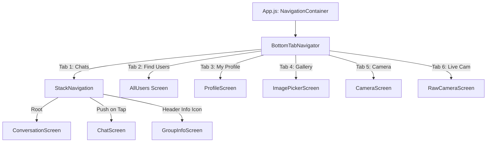

# CampusConnect — Comprehensive Viva Defense & Architecture Notes

> **Course:** Mobile Application Development / Computer Science Engineering  
> **Project:** CampusConnect (Cross-Platform Campus Communication Application)  
> **Framework:** React Native (Expo SDK 58), JavaScript (ES6+), React 19  

---

## 1. Project Introduction

**CampusConnect** is a cross-platform mobile communication application designed specifically for college campuses. It allows students to discover classmates, initiate direct and group discussions, exchange real-time text and photo messages, and view official campus broadcast announcements. Built with React Native and Expo, CampusConnect operates smoothly on Android devices and interfaces with a Node.js REST API backend.

---

## 2. Problem Statement

On university campuses, academic collaboration is often fragmented across multiple social media platforms, leading to privacy concerns, distraction, and lack of verified student-to-student interaction. 

CampusConnect solves this by providing:
- A centralized campus directory of registered students.
- Direct messaging (1-on-1) and topic-based study groups.
- Broadcast announcement channels for official college notifications.
- Integrated camera and media sharing for academic notes and whiteboard captures.

---

## 3. Technologies Used & Why

| Technology | Role | Why It Was Chosen |
|---|---|---|
| **React Native (0.88)** | Mobile UI Framework | Enables cross-platform development (iOS and Android) using a single JavaScript codebase while compiling down to native platform UI widgets. |
| **Expo (SDK 58)** | Development Toolchain | Eliminates the need for local Android Studio / Xcode configuration; provides reliable, battle-tested native plugins for device hardware (Camera, Media Library, File System). |
| **React Navigation 7** | Routing & Navigation | Industry standard for React Native. Provides native screen animations, stack hierarchies (LIFO push/pop), and persistent bottom tab bars. |
| **Fetch API + AbortController** | Networking | Native browser/Node standard for HTTP REST communication. Combined with `AbortController` to guarantee requests time out if the network is sluggish. |
| **Expo Image Picker & Expo Camera** | Hardware Access | Provides both system OS camera intents (simple, battery-efficient) and in-app camera viewfinders for rich interactive controls. |

---

## 4. Application Architecture

CampusConnect follows a **Layered Client-Server Architecture**:

```
┌─────────────────────────────────────────────────────────────┐
│                    CAMPUSCONNECT CLIENT                     │
├─────────────────────────────────────────────────────────────┤
│ 1. Presentation Layer (Screens & Components)                │
│    - Screens: ConversationScreen, ChatScreen, AllUsers,     │
│               ProfileScreen, GroupInfoScreen, CameraScreen  │
│    - Reusable UI: MessageBubble, ConversationCard, UserItem,│
│                   LoadingIndicator, ErrorMessage            │
├─────────────────────────────────────────────────────────────┤
│ 2. Navigation Layer                                         │
│    - NavigationContainer + BottomTabNavigator               │
│    - NativeStackNavigator (Conversation -> Chat -> Group)   │
├─────────────────────────────────────────────────────────────┤
│ 3. Service Layer (api.js)                                   │
│    - getUsers, getConversations, getMessages,               │
│      sendTextMessage, sendImageMessage                      │
├─────────────────────────────────────────────────────────────┤
│ 4. Configuration & Utils                                    │
│    - BASE_URL (http://localhost:3000 via adb reverse)       │
│    - Date/Time & String formatters                          │
└──────────────────────────────┬──────────────────────────────┘
                               │ HTTP REST (JSON)
                               ▼
┌─────────────────────────────────────────────────────────────┐
│                     NODE.JS BACKEND                         │
│   - Endpoints: /user, /user/profile, /conversation, /message│
└─────────────────────────────────────────────────────────────┘
```

---

## 5. Navigation Flow



---

## 6. How API Communication Works

All network requests flow through `src/services/api.js`:
1. **Endpoint Resolution:** Base URL (`http://localhost:3000`) is prepended to relative paths.
2. **Timeout Enforcement:** An `AbortController` is initialized with a 10-second timer. If the server does not respond in time, the connection is aborted to prevent infinite UI loading states.
3. **HTTP Status Validation:** If `response.ok` is false (HTTP 4xx or 5xx), an `Error` object containing the server status is thrown.
4. **Safe JSON Parsing:** Inspects the `Content-Type` header and parses JSON safely, guarding against HTML error pages or empty response bodies.
5. **User-Friendly Error Translation:** Catches network failures and formats human-readable messages (e.g. instructing developers to verify `adb reverse`).

---

## 7. How Users and Conversations are Fetched

### User Directory Fetching
- Invokes `getUsers()` which sends `GET /user`.
- On arrival, state updates via `setUsers(data)`.
- Client-side search filters the array by `name` or `bio` in real time without spamming the backend with search queries.

### Conversation Inbox Fetching
- Invokes `getConversations()` which sends `GET /conversation`.
- Resolves creator display names via `getUserProfile(convo.createdBy)` using `Promise.all`.
- Implements `useFocusEffect` from `@react-navigation/native` so the list refreshes automatically every time the student returns to the inbox tab.

---

## 8. How Direct and Group Conversations are Created

1. **User Selection:** The student toggles classmates from the campus directory. Tapping a student adds them to `selectedUsers`; tapping again removes them. Duplicate participant IDs are strictly prevented.
2. **Type Selection:** The student chooses **DM** (1-on-1) or **Campus Group**.
3. **Input Validation:**
   - For DM: Validates that exactly 1 classmate is selected.
   - For Group: Validates that a group title is provided and at least 1 classmate is selected.
4. **API Request:** Dispatches `createConversation({ type, name, participants_ids })` via `POST /conversation`.
5. **Feedback & Transition:** On success, shows a confirmation dialog and navigates directly to the Conversations inbox.

---

## 9. How Messages are Sent and Displayed

### The Message Flow
$$\text{User Types Message} \longrightarrow \text{UI Validation} \longrightarrow \text{POST /message} \longrightarrow \text{Backend Storage} \longrightarrow \text{UI Auto-Refreshes Thread}$$

1. **Validation:** Checks `currentMessage.trim().length > 0` to block empty/whitespace-only messages. Disables the Send button while sending is active.
2. **Sending:** Calls `sendTextMessage(conversationId, text)` which transmits `{ conversation_id, content }`.
3. **Thread Refresh:** Clears the input, immediately refetches the message list with `getMessages()`, and auto-scrolls `ScrollView` to the newest message at the bottom.
4. **Sent vs. Received Layout:**
   - **Sent Messages:** Rendered on the right with a blue bubble (`#0066cc`) and white text.
   - **Received Messages:** Rendered on the left with a white bubble, member name header, and dark text.
5. **Periodic Polling:** Runs a 5-second polling interval while `ChatScreen` is focused to pull incoming messages from peers.

---

## 10. How Image Sharing Works

1. **Capture / Pick:** Tapping `📷` presents an action dialog to:
   - Take a live photo with the camera (`launchCameraAsync`).
   - Pick an existing photo from the device library (`launchImageLibraryAsync`).
2. **Cancellation Guard:** Safely checks `if (result.canceled || !result.assets) return;` to prevent runtime crashes.
3. **Payload Compression:** Encodes the photo with `quality: 0.6` as a Base64 data URI (`data:image/jpeg;base64,...`).
4. **Upload:** Dispatches `sendImageMessage(conversationId, base64Payload)` to `POST /message`.
5. **Rendering:** `MessageBubble.jsx` detects `message.imageInfo` and renders it via `<Image source={{ uri: message.imageInfo }} />`.

---

## 11. Important Functions & Responsibilities

| Function | File | What It Does & How It Works |
|---|---|---|
| `request()` | `src/services/api.js` | Core network wrapper with 10s `AbortController` timeout and status checks. |
| `getConversations()` | `src/services/api.js` | Retrieves all conversation records for the student. |
| `createConversation()` | `src/services/api.js` | Sends validated JSON payload to create DM or Group conversations. |
| `sendTextMessage()` | `src/services/api.js` | Posts validated text to `POST /message`. |
| `sendImageMessage()` | `src/services/api.js` | Posts Base64 photo string to `POST /message`. |
| `toggleUserSelection()` | `screens/AllUsers.jsx` | Toggles student selection in array without duplicating IDs. |
| `loadConversations()` | `screens/ConversationScreen.jsx` | Fetches and enriches conversations with creator profiles. |
| `handlePickImage()` | `screens/ChatScreen.jsx` | Handles dual camera/gallery selection and cancellation safety. |
| `formatMessageTime()` | `src/utils/formatters.js` | Converts timestamp into readable "HH:MM AM/PM" string. |

---

## 12. Challenges Faced & Solutions

1. **Invisible Text Messages:** Original source code left `<Text></Text>` empty inside the message loop. Resolved by extracting and rendering `item.content`.
2. **Fatal Image Picker Crash:** Cancelling the photo picker caused `TypeError: Cannot read properties of undefined (reading '0')`. Resolved by adding explicit `result.canceled` guards.
3. **Missing `Alert` Import:** Permission denial threw `ReferenceError: Alert is not defined`. Resolved by adding `Alert` to `react-native` imports.
4. **Inconsistent Server Addresses:** Different screens used `10.7.1.89` and `10.7.1.51`. Resolved by unifying configuration in `src/config/api.js` targeting `http://localhost:3000` via Android reverse port forwarding.
5. **Duplicate Participant IDs:** Tapping users repeatedly appended duplicate IDs. Resolved by implementing a toggle selection filter.

---

## 13. Known Limitations

1. **No Backend Authentication:** The backend currently relies on static Basic Auth rather than JWT login/signup tokens.
2. **HTTP Polling vs. WebSockets:** Real-time messaging uses 5-second interval polling because the backend does not expose a WebSocket server.
3. **Base64 Payload Size:** Images are sent as Base64 strings in JSON rather than via a dedicated multipart `/upload` endpoint.
4. **Client-Side Search:** Search filtering is performed in-memory on loaded data because the backend does not offer search endpoints.

---

## 14. Possible Future Improvements

1. **Push Notifications:** Integrating Expo Notifications (`expo-notifications`) for background message alerts.
2. **WebSocket Integration:** Migrating from 5-second polling to Socket.io for instantaneous, battery-efficient message delivery.
3. **Multipart File Storage:** Connecting an S3/Cloudinary object store to host images, transmitting only lightweight URLs over chat.
4. **Voice Notes:** Leveraging `expo-av` and the existing `RECORD_AUDIO` permission to record and transmit audio notes.
